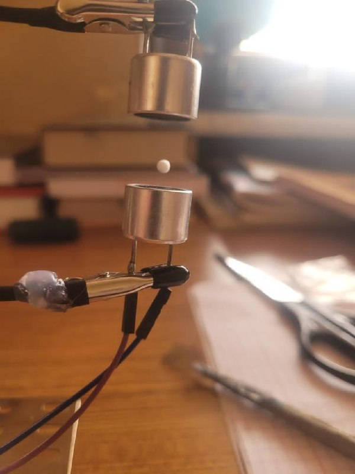
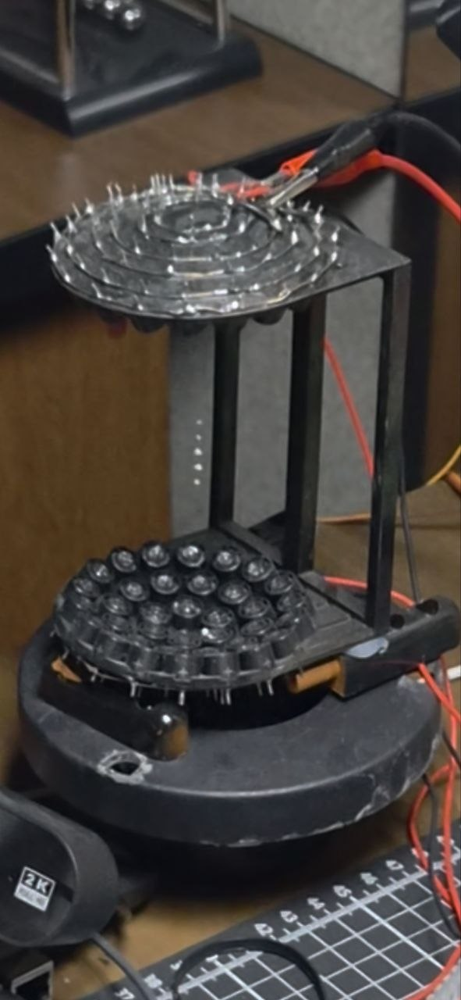
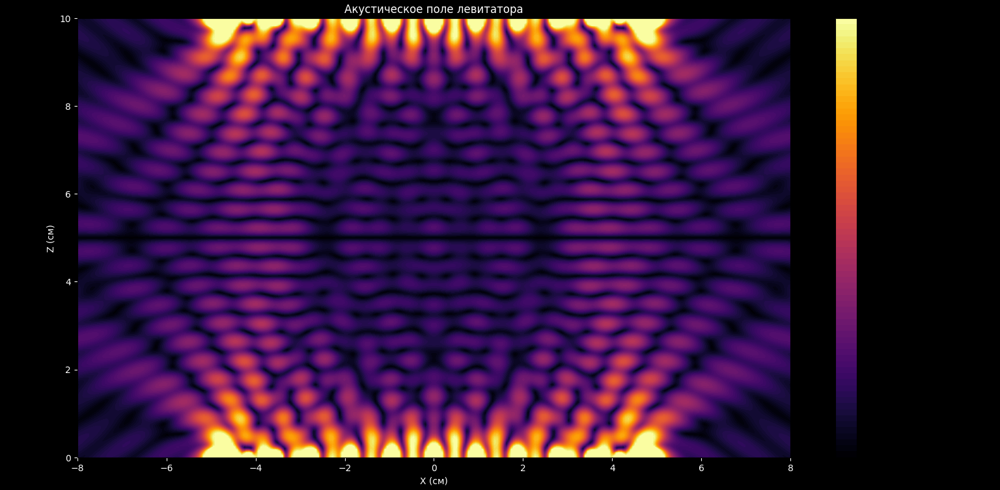

# Ultrasound Acoustic Levitators with Touchless HMI Gesture Control

An engineering research and development project focused on the principles of acoustic levitation, ultrasonic standing wave generation, and Computer Vision based Human-Machine Interface (HMI) integration for contact-free spatial object manipulation.

> **Author:** Armenak Babayan  
> **Purpose:** Academic engineering project developed for the undergraduate admission portfolio.

---

## 🏆 Project Achievements and Awards
* **Olympiad Winner:** This project was awarded **1st Place / Grand Prix** at the Engineering Olympiad, validating its technical novelty, hardware reliability, and software implementation quality before an academic jury.

---

## Project Overview
This project encompasses the design, hardware assembly, and programming of two distinct ultrasonic acoustic levitation systems. It demonstrates the technical progression from a foundational physics experiment to a complex, interactive multi-element phased array driven by a real-time computer vision tracking pipeline.

### System Video Demonstration
Click the banner below to watch the system presentation, dynamic touchless hand-tracking system response, and multi-object acoustic manipulation:

[](https://youtube.com)

### System Specifications and Comparison

| Feature | Version 1 (Baseline) | Version 2 (Advanced Phased Array) |
| :--- | :--- | :--- |
| **Transducer Count** | 2 Ultrasonic Transducers | 64 Ultrasonic Transducers (Matrix Array) |
| **Acoustic Field Type** | One-Dimensional Standing Wave | Focused Phased Array Field |
| **Functionality** | Static Micro-Object Trapping | Dynamic Spatial Object Manipulation |
| **Control Interface** | Automated / Autonomous | Computer Vision Gesture Control (Up / Down via Camera) |
| **Control Software** | Embedded C++ Firmware | Python Backend + Embedded C++ Firmware |

---

## Repository Structure
The project assets are organized into dedicated version directories:
* Version_1/ — Dual-transducer static levitation setup.
  * Code/ — Microcontroller firmware for driving counter-phase signals.
  * Schematics/ — Circuit diagrams for the transducers and motor driver interface.
  * Photos_and_Videos/ — Media demonstrating successful particle entrapment.
* Version_2/ — 64-channel interactive phased array with computer vision hand tracking.
  * Code/ — Microcontroller phase-shifting firmware and Python tracking scripts.
  * Schematics/ — Phased array matrix wiring diagrams and USB-to-Serial interfacing.
  * Photos_and_Videos/ — Video captures showcasing manual object manipulation.

---

## Technical Breakdown

### Version 1: Dual-Transducer Static Levitator
A classic acoustic trapping configuration utilizing two 40 kHz ultrasonic transducers positioned coaxially at a precise distance calibrated to a multiple of the acoustic half-wavelength (λ/2).
* **Physical Principle:** The transducers operate in strict anti-phase alignment, generating a fixed acoustic standing wave. The target micro-objects (e.g., expanded polystyrene particles) are trapped securely at the acoustic pressure nodes where the net acoustic radiation force counters gravity.

#### Version 1 Experimental Proof
Below is the photo demonstration of successful single-particle entrapment within the nodes of the stable standing wave using the baseline dual-transducer hardware architecture:



---

### Version 2: 64-Channel Phased Array Matrix with Computer Vision Control
An advanced hardware-software complex featuring an array of 64 ultrasonic transducers split into two opposing 32-element hemispheres. Instead of relying on dedicated hardware sensor modules, this version implements an intelligent Computer Vision (CV) tracking pipeline using a standard camera feed to establish a real-time Human-Machine Interface (HMI).

* **Physical Principle:** The microcontroller dynamically computes and shifts the phase delays for all 64 channels independently. This modulates the focal point of the pressure field, allowing the acoustic trap to move through three-dimensional space.
* **Computer Vision Tracking Pipeline:** A host Python application processes live video frames to extract hand kinematics and transmit positioning commands over a serial bus:
  * **Hand Landmarks Detection:** Utilizes the Google MediaPipe framework alongside OpenCV (`cv2`) to track multi-dimensional hand landmarks and gesture elevation vectors in real time.
  * **Coordinate Mapping:** The vertical displacement of the tracked hand node is normalized using NumPy (`np`), mapping physical hand coordinates directly to targeted phase-shift steps for the acoustic field.
  * **Serial Communication:** Real-time positioning vectors are streamed asynchronously to the hardware microcontroller over USB using PySerial (`serial`), matching active system ports via auto-discovery protocols.
  * **Data Visualization:** An integrated Matplotlib backend runs concurrently on a dedicated thread (`threading`), generating real-time animated plots of positional telemetry and signal behavior.

---

## Version 2 Media Gallery and Simulation

### Multi-Object Acoustic Trapping Proof
Below is the captured demonstration showing the advanced phased array matrix establishing independent localized nodes to trap and levitate five objects simultaneously in 3D space:



### Acoustic Field Simulation
To validate the phased array algorithm and analyze the standing wave nodes before physical deployment, the Python framework includes a custom computational physics backend. Using mathematical modeling, the script renders a real-time sound pressure matrix mapping:



*The plot displays the acoustic pressure field layout inside the levitation chamber. Dark horizontal bands represent low-pressure acoustic nodes (trapping points), dynamically shifting along the Z-axis in response to real-time MediaPipe hand tracking coordinates over the serial interface.*

### Video Logs (Available in Repository)
The following continuous performance logs are documented inside the repository folder and can be launched directly:
* [Acoustic Field Modulation Log](Version_2/Photos_and_Videos/v2_acoustic_field_modulatio.mp4) — Demonstration of standing wave node behavior and phase-shift field transitions.
* [Vertical Positioning Control Demonstration](Version_2/Photos_and_Videos/v2_vertical_positioning_control.mp4) — Real-time recording of the levitating particle responding to vertical hand coordinates processed via MediaPipe.

---

## Deployment and Replication

### 1. Hardware Assembly
* Navigate to the `Schematics` folder of the respective version to review the wiring topologies, driver layouts, and power requirements (12V DC input baseline).

### 2. Setting Up the Firmware
* Open the source files inside the `Code` directory using the appropriate IDE.
* Compile and flash the embedded C++ codebase onto your microcontroller unit.

### 3. Running the Python Control Pipeline (Version 2 Only)
Ensure you have Python installed on your host system. Install the required dependencies:
```bash
pip install opencv-python mediapipe pyserial numpy matplotlib
```
Execute the main control script to initialize the tracking loop:
```bash
python main_control.py
```

---

## License
This project is open-source and distributed under the MIT License.
